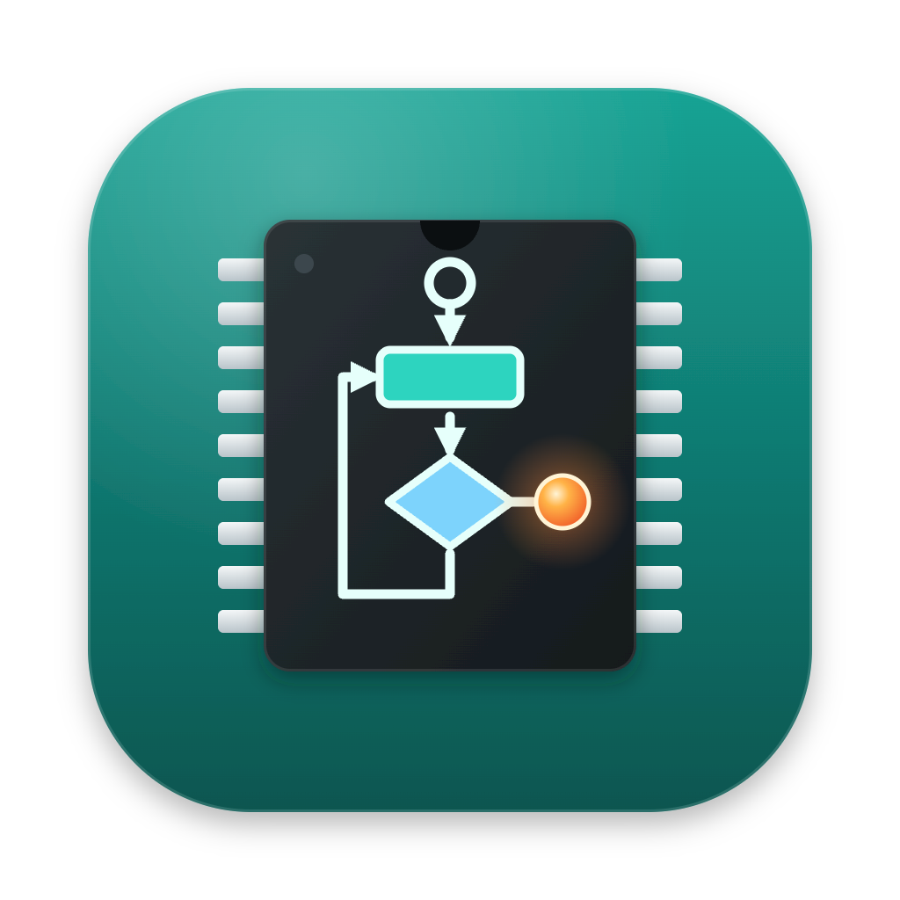

# PIC Studio

A desktop studio for the PIC16F84A: draw a circuit, write MikroC-style C, and watch the compiled program run on a cycle-accurate emulator wired to the schematic, with the generated assembly, registers and flowchart side by side.

## What it does

PIC Studio is a single-window Electron app (it also runs in a browser) with four linked panels:

- **Schematic**: a grid editor with a PIC16F84A, LEDs, logic states, push buttons, resistors, BCD 7-segment displays, traffic lights and an LDR. During simulation, pins and LEDs show their live state and inputs can be toggled.
- **Code**: a CodeMirror editor for the MikroC PRO dialect (`PORTA.RA0`, `sbit`, `absolute`, `Delay_ms`, `void interrupt()`), with French diagnostics and lint warnings for classic beginner mistakes.
- **Assembly / registers**: the generated listing, W, STATUS, PC, the 8-level stack, RAM and program-memory maps, breakpoints, and stepping by instruction or by C line.
- **Flowchart** ("organigramme"): generated from the same program model as the C code, so the two always match.

Around these: a block-based assistant that builds programs without typing C, a "Comprendre" drawer that explains each step and can trace a lit LED back to the C line and condition that drove it, bundled lab templates, and exports (`.c`, Intel HEX, PNG/SVG/PDF captures, a printable wiring sheet, a PDF lab report).

The interface is in French: it was built for a French-language microcontroller course.

## Engineering highlights

- **Compile, don't interpret.** `packages/compiler` is a hand-written compiler for a MikroC subset: lexer, preprocessor, parser, semantic checker, PIC14 code generator, linker with call-graph stack-depth analysis, and Intel HEX output. `Delay_ms` becomes cycle-exact nested `DECFSZ` loops computed from the clock frequency. Sources are read and written as Windows-1252 with CRLF, the way MikroC saves them.
- **Cycle-accurate core.** `packages/emulator` implements the PIC16F84A from the datasheet: the mid-range instruction set, banked SFRs, TMR0 and prescaler, data EEPROM, watchdog and SLEEP, and an interrupt-latency model sampled per instruction cycle. The opcode dispatch is written so V8 can build a jump table.
- **Circuit solver.** `packages/circuit` resolves nets by driver strength (rails, strong drivers, resistive nodes with input hysteresis) and runs a piecewise-linear DC solve for LEDs, so series LEDs and duty-cycle brightness behave realistically. It also includes a reverse-engineered reader for Proteus ISIS binary `.DSN` schematics and an autolayout with an orthogonal wire router.
- **One program model, three views.** `packages/program-model` is shared by the C generator, the flowchart layout and a C-to-model parser, with a round-trip property covered by tests: regenerating from parsed generated code yields the same text.
- **Real-time simulation off the main thread.** A Web Worker runs the emulator and circuit in time slices with a pacer that keeps simulated time aligned with wall time, and can swap in an edited schematic mid-run by transplanting the full CPU state.
- **Hardened Electron shell.** Sandboxed, context-isolated preload exposing fixed channels only; every IPC handler checks the sender frame; navigation and new windows are blocked; the production Content-Security-Policy is generated at build time with script hashes.
- **Verified copilot (optional).** A chat drawer runs the user's own locally installed `claude` CLI headless with a scrubbed environment. Each answer must match a JSON schema and is only shown after its circuit lays out, its code compiles and its simulation tests pass; failures trigger up to two automatic correction turns.

## Tech stack

TypeScript, React 19, Vite 8, Electron 44, zustand, CodeMirror 6, pdf.js, fflate, esbuild, `@electron/packager`, Vitest. npm workspaces monorepo; no backend, and the app itself fetches nothing from the network.

## Project structure

```
app/            React UI: schematic, code, debug, flowchart panels; assistant, learn and copilot drawers;
                exports; simulation worker; zustand store
electron/       Main process, preload, menus, PDF export, IPC security, copilot service
packages/
  emulator/       PIC16F84A core, assembler, disassembler, Intel HEX
  compiler/       MikroC-subset compiler (lexer -> preprocessor -> parser -> sema -> codegen -> link)
  circuit/        Part models, netlist, solver, simulation session, .DSN importer, autolayout, SVG
  program-model/  Structured program shared by generator, parser and flowchart
  style-c/        Program model -> C source and MikroC file export
  organigramme/   Program model -> deterministic flowchart layout -> SVG
  integration/    End-to-end tests: compile, load, simulate inside a circuit
templates/      Bundled lab projects (circuit + program model + C source)
scripts/        Electron dev/build, icon rendering, macOS packaging, packaged-app smoke test
```

## Getting started

Requires Node.js and npm (developed on Node 26). Packaging targets macOS.

```bash
npm install
npm run dev          # browser version on http://localhost:5173
npm run app:dev      # same UI inside Electron, with hot reload
npm test             # Vitest suite
npm run typecheck    # tsc for the workspace and the Electron sources
npm run bench        # emulator and simulation speed benchmarks
npm run package      # build + package "PIC Studio.app" into dist-app/ (ad-hoc signed)
npm run app:smoke    # launch the packaged app and check it starts cleanly
```

No environment variables are required. Optional ones, read by the scripts and the main process: `PIC_STUDIO_DEV_URL`, `PIC_STUDIO_DEVTOOLS`, `PIC_STUDIO_USER_DATA`, `PIC_STUDIO_CLAUDE`, `PIC_STUDIO_VERSION`, `PIC_STUDIO_ARCH`.

Notes:

- The copilot drawer needs the `claude` CLI installed and signed in on the machine; everything else works without it.
- Part of the circuit test suite imports the original course `.DSN` files from a local `cours/` folder that is not distributed with the repository. Without those files, the seven test files that read them are skipped (see `vitest.config.ts`); the rest of the suite is self-contained.

## Status

Coursework-adjacent personal project: a study tool written alongside a second-year microcontroller architecture course at ESPRIT (Tunis). It is not affiliated with or endorsed by the school, Microchip, MikroElektronika or Labcenter; MikroC and Proteus are mentioned only for file-format and dialect compatibility.

It is a working prototype rather than a released product: the macOS build is ad-hoc signed and unnotarized, there are no published binaries, and only the PIC16F84A is supported. The suite has 125 test files (about 1,700 tests; 118 files and about 1,600 tests run without the course circuits) covering the emulator, compiler, circuit solver, flowchart layout and UI logic.

Built by [Hamza Dellai](https://github.com/devhmez).
